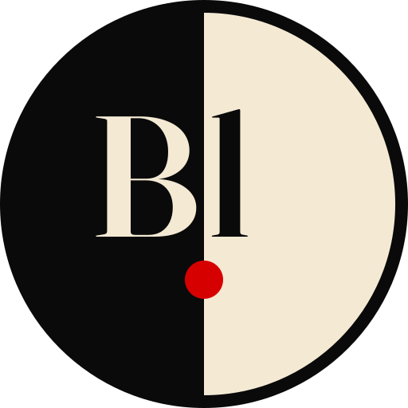
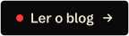

<a id="top"></a>

<div align="center">

<picture>
  <source media="(prefers-color-scheme: dark)" srcset="https://raw.githubusercontent.com/voaneves/blog/main/assets/logo/logo-dark.svg" />
  <source media="(prefers-color-scheme: light)" srcset="https://raw.githubusercontent.com/voaneves/blog/main/assets/logo/logo-light.svg" />
  
</picture>

<h1>Blog do Victor Neves</h1>

<p>
  <strong>Ensaios sobre programação, filosofia, economia e comportamento.</strong><br />
  <sub>Blog pessoal em HTML estático, instalável como PWA</sub>
</p>

<p>
  <a href="https://voaneves.github.io/blog/"><picture><source media="(prefers-color-scheme: dark)" srcset="https://raw.githubusercontent.com/voaneves/blog/main/assets/buttons/live-dark.svg" /></picture></a>
  <a href="#posts"><picture><source media="(prefers-color-scheme: dark)" srcset="https://raw.githubusercontent.com/voaneves/blog/main/assets/buttons/posts-dark.svg" /></picture></a>
</p>

<p><sub>Precisa de algo assim? <a href="https://voaneves.com/#contato"><strong>Vamos conversar →</strong></a></sub></p>

<p>
  <a href="https://github.com/voaneves/blog/blob/main/LICENSE"></a>
  
</p>

<p>
  <a href="https://voaneves.github.io/blog/">Blog</a> ·
  <a href="#posts">Posts</a> ·
  <a href="#como-rodar">Como rodar</a> ·
  <a href="#estrutura">Estrutura</a> ·
  <a href="#contato">Contato</a>
</p>

</div>

<picture>
  <source media="(prefers-color-scheme: dark)" srcset="https://raw.githubusercontent.com/voaneves/blog/main/assets/brand/rule-dark.svg" />
  <source media="(prefers-color-scheme: light)" srcset="https://raw.githubusercontent.com/voaneves/blog/main/assets/brand/rule-light.svg" />
  
</picture>

## Sobre o projeto

Um blog pessoal com ensaios sobre "tudo um pouco": programação, filosofia moderna, economia e comportamento, que você pode ler no navegador ou instalar como app.

**Blog:** <https://voaneves.github.io/blog/>

## Posts

- [**Como começar a programar websites**](https://voaneves.github.io/blog/como-come%C3%A7ar-a-programar-websites.html): ponto de partida para quem quer construir sites.
- [**O pobre que compra iPhone**](https://voaneves.github.io/blog/o-pobre-que-compra-iphone.html): ensaio sobre consumo e escolhas financeiras.
- [**Somos bons ou maus? Um estudo em várias áreas do conhecimento**](https://voaneves.github.io/blog/somos-bons-ou-maus.html): ensaio que cruza diferentes áreas para discutir a natureza humana.

## Como rodar

Não há build nem dependências. Clone e sirva a pasta com qualquer servidor estático (o service worker exige `http://localhost` ou HTTPS):

```bash
gh repo clone voaneves/blog
cd blog
python -m http.server 8000
```

Acesse <http://localhost:8000>.

## Estrutura

```
index.html                           página inicial
como-começar-a-programar-websites.html
o-pobre-que-compra-iphone.html
somos-bons-ou-maus.html
manifest.json                        manifesto PWA
sw.js / sw.min.js                    registro do service worker
worker.js / worker.min.js            service worker
assets/                              fonts, img, js e styles
```

## Stack

HTML, CSS e JavaScript puros; metadados de SEO (description, keywords, Open Graph), tema claro/escuro (`color-scheme`) e PWA com manifest + service worker.

## Licença

O código está sob a licença MIT (veja [LICENSE](https://github.com/voaneves/blog/blob/main/LICENSE)). Os textos dos posts e as imagens são © Victor Neves, todos os direitos reservados.

## Contato

<p>
  <a href="https://voaneves.com/#contato"><picture><source media="(prefers-color-scheme: dark)" srcset="https://raw.githubusercontent.com/voaneves/blog/main/assets/buttons/hire-dark.svg" /></picture></a>
  <a href="https://voaneves.com/"><picture><source media="(prefers-color-scheme: dark)" srcset="https://raw.githubusercontent.com/voaneves/blog/main/assets/buttons/site-dark.svg" /></picture></a>
</p>

<a href="https://linkedin.com/in/voaneves">LinkedIn</a> · <a href="mailto:victorneves478@gmail.com">E-mail</a>

<p align="center">
  
</p>

<p align="center"><sub>Distribuído sob a <a href="https://github.com/voaneves/blog/blob/main/LICENSE">licença MIT</a>.</sub></p>

<p align="center"><sub><a href="#top">↑ Voltar ao topo</a></sub></p>
